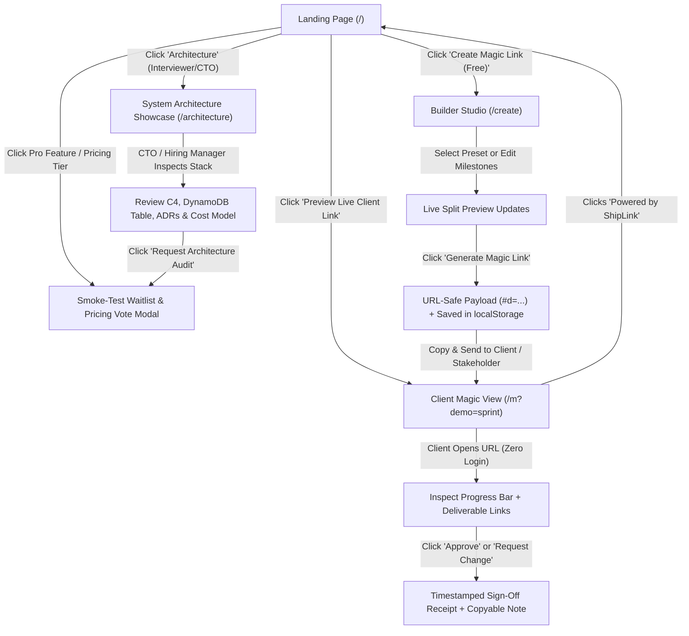

# User Flows & Feature Architecture — ShipLink

---

## 1. End-to-End Multi-Persona Flow



---

## 2. Route & Feature Matrix (All Routes HTTP 200)

| Route | Primary Audience | Core Features | Exit / Conversion Action |
|---|---|---|---|
| **`/`** | Agency founders, devs, consultants, organic/social visitors | - **Above-the-fold hero** with 1-click "Create Magic Link" + "Inspect Live Client Demo"<br>- **Interactive mini-toggle** comparing "Jira/Email Chaos" vs. "ShipLink Magic Card"<br>- **Feature Bento Grid** (10s Zero-Signup Builder, Milestone Sign-Off, GitHub/Linear Auto-Sync [Pro], `/architecture` Proof)<br>- **Comparison Table** (*Jira/Linear vs Heavy Portals vs ShipLink*)<br>- **Transparent Pricing Tiers** (`Free` · `$19/mo Solo` · `$39/mo Team` · `$69 Early-Bird LTD`)<br>- **BLUF FAQ** (structured for humans + LLM citation) | Route to `/create`, `/m?demo=sprint`, or open Pro Waitlist Modal with pre-selected tier |
| **`/create`** | Builders / Consultants creating a status link | - **3 Instant Presets:** *SaaS MVP Sprint*, *AWS / AI Architecture Audit*, *Design & Marketing Retainer*<br>- **Project Header Form:** Project Name, Client/Stakeholder Name, Your Brand/Name, Target Launch Date, Summary Note<br>- **Milestone Editor:** Add/delete items, status selector (`Approved`, `In Review`, `In Progress`, `Planned`), deliverable URL (Staging / Figma / Loom / GitHub PR), description<br>- **Live Real-Time Preview** matching exact `/m` rendering<br>- **1-Click Copy Magic Link** + **"Open Client View"** + **Local Draft History Drawer** (stored in `localStorage`)<br>- **Pro Locked Toggles** (*Auto-sync GitHub PRs*, *Custom Domain*, *Slack Alerts*) triggering Waitlist Smoke Test | Copy working `/m#d=...` URL and send immediately; or vote on Pro features |
| **`/m`** | Clients / Stakeholders / Interviewers testing the magic link | - **Zero-Login Header:** Brand badge, Client Name, Project Title, Last Updated stamp, overall completion `%` bar<br>- **Milestone Feed:** Color-coded status badges, clickable preview buttons (`Open Staging`, `View PR`, `Inspect Doc`), client action buttons on `In Review` milestones<br>- **1-Click Approval / Feedback Drawer:** Lets client type an optional note and confirm approval or change request, instantly displaying a **Signed Status Receipt** + copyable Slack/email snippet<br>- **Viral Loop Footer:** Subtle *"Built with ShipLink — Share client updates without logins in 10s →"* | Client approves deliverable in <15s; curious clients convert to creators on `/` |
| **`/architecture`** | Hiring VPs, Principal Architects, CTO consulting leads | - **Interactive Architecture Explorer:** Switch between *Phase 1 Zero-Cost Edge State* and *Phase 2 AWS Serverless Event-Driven Production*<br>- **Visual C4 Container Diagram** (SVG, responsive)<br>- **DynamoDB Single-Table Access Pattern Reference Table** (`PK`, `SK`, `GSI1`)<br>- **4 Concise ADR Cards** (Why capability URLs vs JWT sessions, Why DynamoDB Single-Table, Why EventBridge fan-out, Why URL-encoded smoke test)<br>- **FinOps Unit Economics Bar** (`$0/mo` smoke test $\rightarrow$ `$4.20/mo` @ 50k links)<br>- **Consulting / Hiring CTA:** Direct links to Sarwan's Portfolio, Resume PDF, & *"Book an AWS / AI Architecture Audit"* modal | Recruiter callback or CTO advisory inquiry |

---

## 3. Magic-Link Client-Side Data Contract (Phase 1 Schema)

To make `/create` $\leftrightarrow$ `/m` 100% functional without a backend in Phase 1, the payload uses a compact versioned JSON schema encoded as UTF-8 URL-safe Base64 inside the URL fragment (`/m#d=...`):

```typescript
export type MilestoneStatus = 'approved' | 'in_review' | 'in_progress' | 'planned';

export interface MilestoneItem {
  id: string;
  title: string;
  status: MilestoneStatus;
  summary: string;
  linkLabel?: string;
  linkUrl?: string;
  approvedAt?: string;
  clientNote?: string;
}

export interface ShipLinkBoard {
  v: 1;
  id: string;
  projectTitle: string;
  clientName: string;
  senderName: string;
  targetDate: string;
  overviewNote: string;
  accent: 'indigo' | 'emerald' | 'slate';
  updatedAt: string;
  milestones: MilestoneItem[];
}
```

### Why Fragment Encoding (`#d=...`)?
1. **Zero Server Data Exposure:** Fragments are never transmitted in HTTP server logs (`GET /m`), preserving privacy even before backend persistence exists.
2. **Infinite $0 Sharing:** Works across tabs, incognito windows, and Slack/WhatsApp pastes immediately on a static Vercel/Cloudflare deployment.
3. **Graceful Transition to Phase 2:** In Phase 2, `/m/<shortId>` resolves from DynamoDB via Lambda while `/m#d=...` remains backward-compatible forever.
