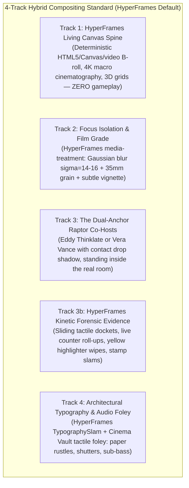

# MASTER CONTENT STRATEGY & PRODUCTION CODEX
> **Scope:** Universal across ALL YouTube channels and digital media ventures under the **ThinkLate** parent holding umbrella (`thinklate`, `off-script`, `sarwanology`).  
> **Status:** Live & Session-Persistent. Binding on all autonomous agents, subagents, and editors.  
> **Last Synthesis:** November 6, 2026.

---

## 1. The Multi-Channel Holding Architecture

All media channels are consolidated under the **ThinkLate** umbrella, sharing a centralized asset vault, motion graphics engine, and production pipeline, while maintaining distinct brand personalities:

```
                            THINKLATE PARENT HOLDING
                               (digital-lab/)
                                     │
      ┌──────────────────────────────┼──────────────────────────────┐
      ▼                              ▼                              ▼
ThinkLate Media (Flagship)    Off Script by ThinkLate        Sarwanology
(@wethinklate)                (@OffScriptEddy)               (@sarwanology)
• Intellectual Infotainment   • 4K Gameplay Archives         • Personal / Philosophical
• Business & Monopoly Traps   • Unfiltered Reactions         • Deep Cultural Essays
• Frontier AI & Physics       • Zero-Stakes Speaking Lab     • Thought Syntheses
• 6-8 min Long / 60s Shorts   • Longplay Walkthroughs        • Experimental Long-Form
```

---

## 2. The Core Visual Standard: The Hybrid Engine & The Dual-Anchor Raptor Syndicate

To simultaneously achieve **high sponsor credibility** and **high viral relatability**, all ThinkLate productions adhere to the **HyperFrames Living Canvas + Real Footage Base + Cutout Avatar Narrator** hybrid compositing standard:



### The Dual-Anchor Cast & Anti-Wallpaper Law (NEVER call them "Owl" or "Falcon" in audio):
1. **Eddy Thinklate (Founder & Lead Host — Owl Avatar):**
   * **Visuals:** Great horned ear-tufts, thin wire glasses, dark coat with **Champagne Gold piping (`#C5A059`)**, strictly 2 arms.
   * **Role:** Executive authority, macroeconomic paradoxes, system traps. Addressed in spoken audio strictly as **Eddy**.
2. **Vera Vance (Forensic Investigator — Falcon Avatar):**
   * **Visuals:** Sharp angular crest, cropped dark blazer with **Hazard Orange piping (`#FF5500`)**, holographic stylus pen, feminine silhouette.
   * **Role:** Forensic auditing, contract clauses, unredacted regulatory leaks. Addressed in spoken audio strictly as **Vera**.
3. **Standalone Climax Short Law:**
   * Every Short (`S##`) must be a 100% standalone, complete video (48–58s) ending on a decisive **Mic-Drop Climax**. Ending a Short on a question, cliffhanger teaser, or unfinished sentence is permanently banned.
3. **The Anti-Wallpaper Rule ($\le$ 20–25% Screen Time):**
   * Characters must **never be permanent on-screen wallpaper**.
   * Strictly appear for $\le$ 20–25% of runtime to deliver high-impact opening hooks, pattern interrupts, and evidence pointing.
4. **The Fast-Paced Hook Law ($\le$ 2.5s State Shifts):**
   * The opening 30–60 seconds must shift visual states every $\le$ 2.5s to maintain viewer dopamine and eradicate swipe-aways.

### The 10–18 Second Thematic Scene Law (Post-Hook):
* **Permanent Ban on Frantic Cut Whiplash:** After the initial hook, visual scenes anchor complete logical thoughts (**10 to 18 seconds**).
* **Continuous Visual Evolution:** The camera maintains a continuous slow 35mm push-in, while internal accents (yellow highlighter wipe, red rubber stamp slam, rolling counter, or avatar expression shifts) animate in real-time sync with spoken nouns.

---

## 3. The Central Master Asset Vault (`shared/assets/`)

A single, centralized repository accessible by all channels, eliminating repetitive web searching and asset duplication:

```
digital-lab/03-content-lab/shared/assets/
├── anime/                   ──> Ingested from animeclips.online & local Videos/Clips/
├── cinema/                  ──> Ingested from Clip.Cafe & iconic cinema compilations
├── memes/                   ──> Transparent green-screens & trending reaction clips
├── sfx/cinema_vault/        ──> Tactile paper slides, vintage camera shutters, warm sub-bass
├── compilations_raw/        ──> Full downloaded editor packs before auto-slicing
├── stocks/                  ──> Curated 4K real-world cinematography
└── VAULT_CATALOG.db         ──> Fast SQLite index searchable by mood, tags, and duration
```

### Sourcing Strategy (The Compilation Pack Model):
* **Stop One-Off Scraping:** The pipeline downloads high-engagement YouTube/TikTok editor compilation packs (*"Top 100 Green Screen Memes for Editors"*, *"Anime 4K Twixtor Pack"*).
* **Automated FFmpeg Scene Splitting:** Uses FFmpeg scene detection (`select='gt(scene,0.35)'`) to automatically slice 4-minute compilations into 40+ clean, pre-trimmed 2-to-3-second micro-cuts registered in `VAULT_CATALOG.db`.
* **Local PC Integration:** Directly catalogs and symlinks existing files on the host PC:
  * `C:\Users\sar1s\Videos\Clips\` (196+ pre-cut anime cuts: *Koe no Katachi*, *Your Name*).
  * `C:\Users\sar1s\Pictures\meme\` (local cultural memes).
  * `C:\Users\sar1s\Downloads\Paper SFX\` (tactile foley packs).

---

## 4. Decoupled Parallel Pipelines (Rule 29)

Shorts and Long-Form productions run on **two strictly independent, parallel tracks**:

| Parameter | Short-Form Pipeline (`shortForm/S##`) | Long-Form Flagship Pipeline (`longForm/L##`) |
|---|---|---|
| **Role** | Rapid experimentation, hook testing, viral reach | Intellectual authority, deep affinity, high RPM |
| **Duration** | 45–60 seconds (standalone velocity) | 6–8 minutes (1,200–1,500 words) |
| **Structure** | 3-part micro-arc + circular end-loop | **6 Connected 75-Second Nested Sprints** |
| **Pacing** | 1.5s visual state shifts, rapid dual-coding | 10–18s evolving thematic scenes |
| **Cadence** | 2–3 standalone Shorts per week | 1 master documentary every 7–10 days |
| **Topic Link** | Share thematic universe, ZERO script dependencies | Standalone deep-dive masterclass |

### Mandatory Self-Contained Publishing Pack (`publishing_pack/`):
Every video folder must contain a dedicated `publishing_pack/` with:
1. `ThinkLate_L##_..._MASTER.mp4` or `ThinkLate_S##_..._MASTER.mp4`
2. `subtitles_en.srt`
3. Final 16:9 thumbnails or vertical cover keyframes
4. `COPY_PASTE_METADATA.txt` (Title options, Description, Tags, Pinned Comment, Settings)

---

## 5. Voiceover Protocol: Default Synthesizer & The Dual-Anchor Pipeline

All ThinkLate voiceover production is standardized on `synthesize_thinklate_voice.py` (`digital-lab/03-content-lab/shared/tools/`):

```bash
# Eddy Thinklate (Founder & Lead Host — Gemini 'Charon')
python digital-lab/03-content-lab/shared/tools/synthesize_thinklate_voice.py --speaker owl --text "..." --out <path.wav>

# Vera Vance (Forensic Investigator — Gemini 'Kore')
python digital-lab/03-content-lab/shared/tools/synthesize_thinklate_voice.py --speaker falcon --text "..." --out <path.wav>
```

### The Two-Phase Workflow:
1. **Phase 1 (Primary Engine — Google Gemini 2.5 Flash Preview TTS via `v1alpha`):**
   * Natural human breathing, emotional acting, and zero robotic cadence (`owl` / Eddy: `Charon` voice with warm documentary host style direction; `falcon` / Vera: `Kore` voice with sharp investigative style direction).
   * **Gentle Broadcast Mastering:** Clamps awkward pauses >350ms while preserving natural micro-breaths, mastered to 48kHz stereo, `-16 LUFS`, true peak `-1.0 dB`.
   * **Automatic Fallback (`--engine edge`):** Edge-TTS (`ChristopherNeural` / `AvaNeural` with <65ms silence compression) runs automatically only if `GEMINI_API_KEY` is unavailable or quota-limited.
2. **Phase 2 (Optional Founder Voice Clone):**
   * Local reference clones or recorded narration referencing `public/audio/owl_executive_hook.wav` and `falcon_investigation.wav`.
   * Seamless drop-in replacement with automatic Whisper timestamp alignment.

### Alternating Shorts vs. Rotational Long-Form:
* **Shorts (60s):** Single host per short. Odd Shorts (S01, S03...) hosted by Mr. Owl; Even Shorts (S02, S04...) hosted by The Falcon.
* **Long-Form (6–8 min):** Ping-ponging dual-anchor dialogue every 20–30 seconds. Mr. Owl opens executive macro traps; The Falcon audits forensic evidence cards.

---

## 6. The 7 Thumbnail, Multi-Style Rotation & Cold-Start Design Laws (7-Video Corpus Aligned)

*Full 2-tier breakdown (Universal Mandatory Laws vs. Locked Channel Matrices) in `digital-lab/03-content-lab/shared/CORPUS_PLAYBOOK_UNIVERSAL_VS_EXPERIMENTS.md`.*

1. **Single Unified Canvas (`<= 2–3` Focal Points Ceiling):** Zero split-screens and zero cluttered 4-layer collages. Strictly at most 2–3 distinct elements reading cleanly within **500ms** along a Rule of Thirds / Left-to-Right Zigzag.
2. **Channel-Specific Locked 4-Style Rotational Matrices (Re-Used per Video Topic):**
   * **ThinkLate (`@wethinklate`) — 4 Reusable Styles:** **TL-1** *Infographics Show / Kurzgesagt 2D Vector & Vox Editorial Collage (preserved baseline)*; **TL-2** *Everyday Prop + Cash Fusion (`Zero1`)*; **TL-3** *Executive / Titan + Jagged Red Crash Line (`ColdFusion`/`Mohak`)*; **TL-4** *Macro Eye + Luminous Phenomenon Spotlight (`Veritasium`/`Fern`)*.
   * **Off Script (`@OffScriptEddy`) — 4 Game-Authentic Faceless Styles (`0` Cartoon Faces):** **OS-1 (Official #1 Baseline)** *Mystery Fog Wet-Deck Watch/Compass Close-Up + Distant Fog Ships (`Frost`)*; **OS-2** *Scenic Impact & Back-Turned Harbor Stealth (`Var 4`/`Var 2`/`Var 3`)*; **OS-3** *Close 1st-Person Hands POV (`Style 4` stealth peeking / `Var 1` helm broadside)*; **OS-4** *Crisp Modern 2D Anime / Concept Art (`Style 5` Hurricane Waterspout / `Style 2` Split-Waterline Cutaway)*.
3. **Real Archives Over 100% AI Slop:** Anchor both thumbnails and video storytelling in real receipts, filings, screenshots, honest game world moments, and archival proof first — avoid raw 100% AI slop or literal word-by-word B-roll assembly (`fObsjdBxTjc`).
4. **Dual Light Mode + Dark Mode Contrast:** Design using Complementary / Split-Complementary palettes (`#E2FF00`, `#FF2A4B`, crisp minimal Light vs Deep Obsidian `#060910`) so thumbnails separate sharply on both `#FFFFFF` and `#0F0F0F` mobile feeds (`9_7q6vUaRsM`).
5. **100% Textless Base Art + Canva Overlay Workflow (`1+1=3` Law):** Generate all base art **100% textless** with reserved negative space, then add `0–3` sharp architectural words (`Montserrat Black` / `Anton`) in **Canva** — never repeating title words.
6. **Outlier-First Search & Cold-Start Similarity + Subversion (`6i1ZGqQMPgc`):** Filter thumbnail research strictly by **Most Viewed / Outlier Videos (`>= 3x–10x`)** first, and balance $\text{Uniqueness} = (\text{Perspective} \times \text{Subversion}) + \text{Voice} + \text{Format}$ so formats stay recognizable to the target audience while looking visually distinct from competitors.
7. **Hard `< 30s` Promise Bridge (`U8Rv32ApRHc`):** Open on an `I+C+C` 3-second hook (*Say It + Show It + Write It + J-cut SFX*) and resolve/advance the thumbnail+title promise inside `0:00–0:30` to keep early attrition `< 40%`.

---

## 7. The Competitive Advantage: Solo Swarm vs. 100-Person Team

| Benchmark | Aevy TV / AEOS Group | ThinkLate (Solo Founder + Swarm) |
|---|---|---|
| **Human Overhead** | 100+ editors, scriptwriters, and managers. $1,500–$4,000 payroll burn/video. | **Solo creator with $0 marginal labor cost.** 100% free-tier & local compute. |
| **Motion Pipeline** | Manual keyframing in After Effects (40–80 hours/video). | **Centralized Remotion Suite (`shared/motion_engine`):** 39 broadcast templates rendered via GPU in 90 seconds. |
| **Turnaround** | 7–14 days per video due to internal approvals. | **24–48 hours.** Rapid topic turnaround on breaking news. |
| **Editorial Tone** | Sanitized to protect corporate agency clients (YAAS) and course sponsors. | **Unfiltered, satirical, cynical, and intellectually fearless.** |
