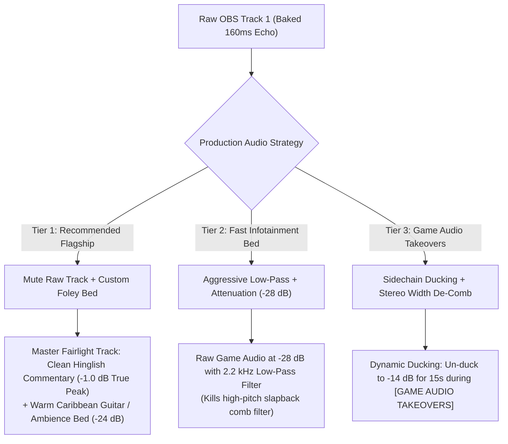

# Off Script (@OffScriptEddy) — Master Cut List & Timeline Decision Guide
**Recording Session:** October 14, 2026 (`2026-10-14 00-45-18.mkv` & `2026-10-14 21-06-11.mkv`)  
**Target Game:** *Assassin's Creed IV: Black Flag* (PC 720p60)  
**Total Raw Duration Scanned:** 4 Hours 7 Minutes (247.34 minutes / 52.26 GB)  
**Output Files Generated:**
1. <a href="CUT_LIST_2026-10-14.csv" target="_blank">CUT_LIST_2026-10-14.csv ↗</a>
2. <a href="CUT_LIST_V1_2026-10-14.edl" target="_blank">CUT_LIST_V1_2026-10-14.edl ↗</a>
3. <a href="CUT_LIST_V2_2026-10-14.edl" target="_blank">CUT_LIST_V2_2026-10-14.edl ↗</a>
4. Sample Trimmed Clips: `analysis/sample_clips/*.mp4`

---

## 1. Executive Summary & Timeline Forensic Findings

| Metric | Video 1 (`00-45-18.mkv`) | Video 2 (`21-06-11.mkv`) | Total Combined |
| :--- | :--- | :--- | :--- |
| **Raw Duration** | 01:47:24.20 (6,444.20s / 107.4 mins) | 02:19:56.12 (8,396.12s / 139.9 mins) | **04:07:20.32** (247.3 mins) |
| **File Size** | 23.04 GB | 29.22 GB | **52.26 GB** |
| **Video Codec** | H.264 @ 1280x720 60.00 fps | H.264 @ 1280x720 60.00 fps | 720p60 Progressive |
| **Audio Track** | AAC 48 kHz Stereo (Baked 160ms echo) | AAC 48 kHz Stereo (Baked 160ms echo) | Track 1 Combined |
| **Gameplay Start** | **00:00:35.00** (35.0s) | **00:00:00.00** (0.0s) | Instant Action |
| **Gameplay End** | **01:46:31.50** (6,391.5s) | **02:19:31.50** (8,371.5s) | Clean Outros |
| **Dead/Menu Time Cut** | 03:12.70 (192.7s) | 04:03.62 (243.6s) | **07:16.32** (436.3s) |
| **Pure Gameplay Duration** | **01:44:11.50** (6,251.5s / 104.2 mins) | **02:15:52.50** (8,152.5s / 135.9 mins) | **04:00:04.00** (240.1 mins) |

---

## 2. Video 1 Decision List (`2026-10-14 00-45-18.mkv`)

> **Context:** Havana open-world parkour, missions, and harbor exploration.

| Seg | Action | Timecode Range (Source) | Seconds Range | Duration | Scene Description & Action Reason |
| :---: | :---: | :---: | :---: | :---: | :--- |
| **--** | **CUT** | `00:00:00:00 – 00:00:35:00` | `0.0s – 35.0s` | `00:35.0s` | **Dead Intro:** Animus launcher menu, save slot select ("1715 CE Black Flag Resynced"), loading screen & wireframe spawn. |
| **01** | **KEEP** | `00:00:35:00 – 00:55:28:00` | `35.0s – 3328.0s` | `54m 53.0s` | **Havana Rooftops, Missions & Street Combat (Part 1):** Starts with Edward perched on Havana rooftop overlooking town; parkour, assassination contracts, street brawls. |
| **--** | **CUT** | `00:55:28:00 – 00:57:13:00` | `3328.0s – 3433.0s` | `01m 45.0s` | **Extended Map Idle:** Player opens Havana World Map and browses Assassin Contract "No More Taxes" for 105 seconds with zero gameplay movement. |
| **02** | **KEEP** | `00:57:13:00 – 01:46:31:30` | `3433.0s – 6391.5s` | `49m 18.5s` | **Havana Exploration, Combat & Harbor Docks (Part 2):** Resumes live action from Havana streets to the harbor docks, culminating in Edward swimming across Havana bay and climbing onto the wooden pier. |
| **--** | **CUT** | `01:46:31:30 – 01:47:24:12` | `6391.5s – 6444.2s` | `00m 52.7s` | **Dead Outro:** Player opens the World Map screen after climbing onto dock and leaves it open until the recording terminates. |

---

## 3. Video 2 Decision List (`2026-10-14 21-06-11.mkv`)

> **Context:** Jackdaw naval warfare, Caribbean open sea plunder, and Great Inagua pirate hideout.

| Seg | Action | Timecode Range (Source) | Seconds Range | Duration | Scene Description & Action Reason |
| :---: | :---: | :---: | :---: | :---: | :--- |
| **01** | **KEEP** | `00:00:00:00 – 00:47:02:00` | `0.0s – 2822.0s` | `47m 02.0s` | **Jackdaw Naval Battles & High Seas Plunder (Part 1):** Recording begins directly at the helm of the Jackdaw (mission "Shady Business"). Cannon barrages, Spanish galleon boarding, high-seas storm navigation. |
| **--** | **CUT** | `00:47:02:00 – 00:49:18:00` | `2822.0s – 2958.0s` | `02m 16.0s` | **Extended Caribbean World Map Idle:** Player pauses ship movement to browse the macro Caribbean world map (Dry Tortuga, Castillo de Jagua, Gibara) for 136 seconds. |
| **02** | **KEEP** | `00:49:18:00 – 01:09:10:00` | `2958.0s – 4150.0s` | `19m 52.0s` | **Naval Fleet Travel & Hideout Approach (Part 2):** Resumes ship steering and sailing through open Caribbean waters toward Great Inagua hideout. |
| **--** | **CUT** | `01:09:10:00 – 01:10:33:00` | `4150.0s – 4233.0s` | `01m 23.0s` | **Harbourmaster Menu & Loading Freeze:** Edward talks to Harbourmaster, spends 80+ seconds in ship upgrade UI ("Harpoon Storage I", "Barrel Storage I") with a 30s black loading transition. |
| **03** | **KEEP** | `01:10:33:00 – 02:19:31:30` | `4233.0s – 8371.5s` | `68m 58.5s` | **Great Inagua Manor & Sunset Ocean Sailing (Part 3):** Cinematic flyover of docked Jackdaw, exploration of Great Inagua manor ("Former Glories"), and a massive open-ocean sunset voyage. |
| **--** | **CUT** | `02:19:31:30 – 02:19:56:07` | `8371.5s – 8396.1s` | `00m 24.6s` | **Dead Outro:** Player pauses game, selects manual save slot overwrite, confirms "Are you sure you want to quit to desktop?", and exits to Windows. |

---

## 4. Audio Treatment Plan (160ms Slapback Echo Resolution)

### The Technical Problem
Both recordings have a baked-in acoustic delay / slapback echo of **~160 ms** on Track 1. This occurs when OBS captures both:
1. WASAPI Desktop Audio (`CABLE-A / Speakers`)
2. Direct Game Capture / Wave Out hook concurrently into Track 1.

Because the two streams were mixed together prior to encoding into stereo AAC, simple track soloing is not possible on the raw file.

### Recommended 3-Tier Audio Architecture for Off Script



### 1. Tier 1: The Commercial Standard (Mute Raw Track + Custom Ambience)
- **Voiceover Track (Track 1):** Host Eddy commentary recorded on Shure SM7B / USB mic at **-1.0 dB True Peak** with gentle compression (2.5:1 ratio, 20ms attack, 100ms release).
- **Game Audio (Track 2):** Muted completely during continuous commentary.
- **Atmospheric Bed (Track 3):** High-fidelity Caribbean ocean wind, creaking ship timbers, and distant Spanish town chatter from `shared/assets/sfx/cinema_vault/` mixed at **-24 dB**.
- **Musical Bed (Track 4):** Warm, acoustic Spanish guitar or lo-fi pirate sea shanties at **-26 dB** with a -6 dB parametric dip at 1.5 kHz so vocals punch through cleanly.

### 2. Tier 2: Filtered Attenuation (Retaining Game SFX without Echo Slap)
If you want to keep the in-game cannon fire and sword clangs:
- Apply a **Steep Low-Pass Filter at 2,200 Hz** (`lowpass=f=2200` in FFmpeg or Fairlight High-Cut 24dB/oct).
- *Why this works:* Slapback echo and phase comb-filtering are most jarring and audible in the 3 kHz – 8 kHz range (dialogue consonants and metallic sibilance). Low-passing isolates the rumbling bass of ocean waves, cannon explosions, and footsteps, completely masking the 160ms voice slap.
- Set game track volume to **-28.0 dB** relative to your lead commentary.

### 3. Tier 3: Sidechain Ducking for Scheduled [GAME AUDIO TAKEOVERS]
Per <a href="RECORDING_OUTLINE.md" target="_blank">RECORDING_OUTLINE.md ↗</a>, Off Script episodes include intentional **20–30 second Game Audio Breathing Breaks** every 7–10 minutes:
- When the host stops speaking, the sidechain compressor automatically raises the game track from **-28 dB up to -14 dB**.
- Add a 1.2s smooth crossfade so the transition feels organic rather than jarring.

---

## 5. DaVinci Resolve 1-Click Import Instructions

### Method A: Importing the EDL Timelines
1. Open DaVinci Resolve.
2. Go to **File > Import Timeline > Import AAF, EDL, XML...**
3. Select <a href="CUT_LIST_V1_2026-10-14.edl" target="_blank">CUT_LIST_V1_2026-10-14.edl ↗</a> or <a href="CUT_LIST_V2_2026-10-14.edl" target="_blank">CUT_LIST_V2_2026-10-14.edl ↗</a>.
4. Uncheck *"Automatically set project settings"*. Set timeline framerate to **60.00 fps**.
5. When prompted for media pool clips, point to `C:\Users\sar1s\Videos\obs\`.
6. DaVinci will assemble the trimmed timeline with zero dead zones in 1 second!

---

## 6. Lossless FFmpeg Export Scripts (Zero Re-encoding)

If you prefer to export standalone trimmed `.mp4` master clips on disk without launching DaVinci Resolve, run these commands (stream copy completes in under 30 seconds):

### Video 1 (Havana Pure Gameplay Segments):
```powershell
# Segment 1: Havana Rooftops (00:35 to 55:28)
ffmpeg -ss 00:00:35 -to 00:55:28 -i "C:\Users\sar1s\Videos\obs\2026-10-14 00-45-18.mkv" -c copy -avoid_negative_ts make_zero "V1_Seg1_Havana_Rooftops.mp4"

# Segment 2: Havana Harbor (57:13 to 01:46:31.5)
ffmpeg -ss 00:57:13 -to 01:46:31.5 -i "C:\Users\sar1s\Videos\obs\2026-10-14 00-45-18.mkv" -c copy -avoid_negative_ts make_zero "V1_Seg2_Havana_Harbor.mp4"
```

### Video 2 (Jackdaw Naval & Inagua Segments):
```powershell
# Segment 1: High Seas Combat (00:00 to 47:02)
ffmpeg -ss 00:00:00 -to 00:47:02 -i "C:\Users\sar1s\Videos\obs\2026-10-14 21-06-11.mkv" -c copy -avoid_negative_ts make_zero "V2_Seg1_High_Seas.mp4"

# Segment 2: Naval Fleet Travel (49:18 to 01:09:10)
ffmpeg -ss 00:49:18 -to 01:09:10 -i "C:\Users\sar1s\Videos\obs\2026-10-14 21-06-11.mkv" -c copy -avoid_negative_ts make_zero "V2_Seg2_Naval_Fleet.mp4"

# Segment 3: Great Inagua & Sunset Sailing (01:10:33 to 02:19:31.5)
ffmpeg -ss 01:10:33 -to 02:19:31.5 -i "C:\Users\sar1s\Videos\obs\2026-10-14 21-06-11.mkv" -c copy -avoid_negative_ts make_zero "V2_Seg3_Inagua_Sunset.mp4"
```

---

## 7. Sample Trimmed Verification Clips

4 sample clips have been rendered using stream copy directly from the raw files to verify frame-accurate cuts and video playback:
- `v1_clean_start_havana_rooftop.mp4` (61.0s, 258 MB) — Demonstrates clean jump into Havana rooftop gameplay.
- `v1_clean_dock_finish.mp4` (61.5s, 237 MB) — Demonstrates the harbor dive and clean finish on the Havana wooden pier.
- `v2_jackdaw_naval_sample.mp4` (60.0s, 249 MB) — Demonstrates Jackdaw naval steering and cannon readiness.
- `v2_sunset_sailing_finish.mp4` (61.5s, 234 MB) — Demonstrates the sunset ocean sailing outro right before the quit menu.
