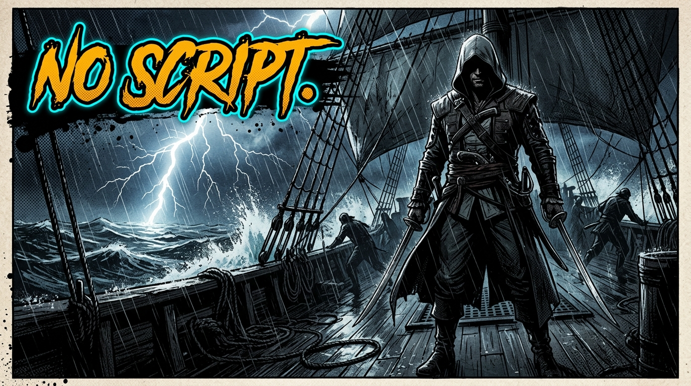
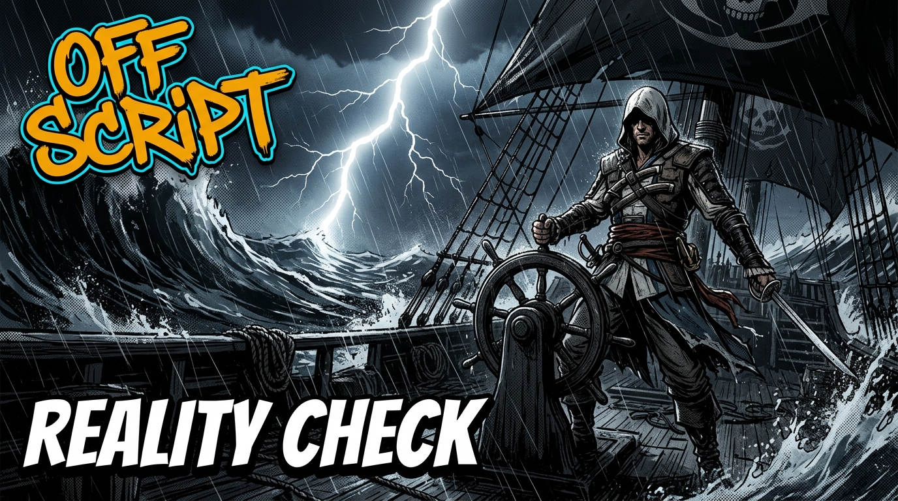

# Off Script Episode 01 — YouTube Publishing Pack
> **Channel:** Off Script (`@OffScriptEddy`)  
> **Host:** Eddy (The Unfiltered Developer / Gamer)  
> **Game:** Assassin's Creed IV: Black Flag (PC Gameplay)  
> **Audio Track:** <a href="audio/take1.mp3" target="_blank">take1.mp3 ↗</a> (Duration: 01:05:54)  
> **Gameplay Footage:** <a href="../../../../../../YOUTUBE/#final_videos/ACBF_Full_GamePlay_1.mp4" target="_blank">ACBF_Full_GamePlay_1.mp4 ↗</a>  

---

## 1. 3-Way Title A/B/C Test Suite (<60 Characters)

* **Title A (Thematic Commentary & Anti-Clickbait - Recommended):**  
  `The Identity Crisis Nobody Talks About [AC Black Flag]` (54 chars)  
  *CTR Hypothesis:* Blends the deep conversational hook with clear game context. Zero tech fluff, pure curiosity.

* **Title B (Nostalgic Classic Benchmark):**  
  `Playing AC Black Flag in 2026 Hits Completely Different` (55 chars)  
  *CTR Hypothesis:* Captures nostalgic gamers revisiting an all-time classic 12 years after release.

* **Title C (Walkthrough & Immersion Intent):**  
  `Off Script | AC Black Flag — Havana Storm & Real Talk` (52 chars)  
  *CTR Hypothesis:* Captures authentic walkthrough searches while establishing the Off Script brand.

---

## 2. 3-Way Thumbnail Suite (Evaluated Assets in `brand/`)

### Variant 1 (Active & Selected — Balanced Gameplay & Brand Anchor):
* **Direct File Link:** <a href="../../brand/thumbnail_ep01.jpg" target="_blank">thumbnail_ep01.jpg ↗</a> (also saved as <a href="../../brand/thumbnail_v2_blackflag2026.jpg" target="_blank">thumbnail_v2_blackflag2026.jpg ↗</a>)

<a href="../../brand/thumbnail_ep01.jpg" target="_blank"></a>

* **Visual:** Edward Kenway in hooded gear with twin cutlasses and flintlocks, rocky coast, Spanish galleon in lightning storm.
* **Text Punch:** `OFF SCRIPT` (amber/cyan) + `BLACK FLAG in 2026` (distressed stark white).
* **Verdict:** 100% transparent. Tells the viewer immediately: this is Off Script playing Black Flag in 2026.

---

### Variant 2 (Thematic / Intellectual Curiosity Hook):
* **Direct File Link:** <a href="../../brand/thumbnail_v3_realitycheck.jpg" target="_blank">thumbnail_v3_realitycheck.jpg ↗</a>

<a href="../../brand/thumbnail_v3_realitycheck.jpg" target="_blank"></a>

* **Visual:** Edward Kenway gripping the helm of the Jackdaw in towering ocean waves and thunder.
* **Text Punch:** `OFF SCRIPT` (top-left) + `REALITY CHECK` (bottom-left).
* **Verdict:** High emotional tension. Matches the identity crisis / global anarchy discussion.

---

### Variant 3 (Minimalist Noir Comic Inking):
* **Direct File Link:** <a href="../../brand/thumbnail_v1_noscript.jpg" target="_blank">thumbnail_v1_noscript.jpg ↗</a>

<a href="../../brand/thumbnail_v1_noscript.jpg" target="_blank"></a>

* **Visual:** Silhouette assassin pirate on ship deck under driving rain.
* **Text Punch:** `NO SCRIPT.` (hazard amber).
* **Verdict:** Stylistic, but lower context. Best when paired with Title A or B.

---

## 3. YouTube Video Metadata (Derived Autonomously from Spoken Take)

### Video Description (Copy-Paste Ready):
```text
Raw PC gameplay of Assassin's Creed IV: Black Flag paired with an unfiltered conversation about identity crisis, childhood bullying, the corporate rat race, and civilizational memory. 

No corporate script. No PR filter. Just real thoughts while sailing the Caribbean.

TIMESTAMPS:
00:00 - The 3 Tiers of Identity Crisis (Personal, Societal, Civilizational)
02:28 - School Bullying: The Scars Nobody Talks About
04:24 - Arcade Era Nostalgia: Tekken 3, Mustafa & 8-Bit Cartridges
07:30 - AC Black Flag in 2026 vs Modern Gaming (One Piece Soul)
09:20 - The 1:30 AM WhatsApp Chat: Why Corporate Jobs Can't Free You
10:45 - The Unspoken Reality: Expelled from School Assembly for Fees
12:10 - Bullying Below the Poverty Line & Fetching Balls from Gutters
15:10 - Childhood Trauma as the Root of Modern Adult Crisis
24:46 - The Corporate Rat Race, Office Gossip & Illusions of Friendship
27:07 - Why Absolute Freedom Doesn't Exist in 2026
32:38 - Doflamingo's Law: "Whoever Wins Becomes Justice"
34:44 - Carrying Water Buckets & Sacrifices of Middle-Class Parents
37:37 - Civilizational Trauma: Invasions & The British "Mental Slavery" Model
41:35 - Macaulay's 1835 Minute on Education: Brown Skin, British Minds
44:17 - Manufactured Social Divisions & The Ellora Kailasa Temple Truth
46:10 - The Erosion of Indigenous Philosophy: Dharma, Karma & Moksha
55:09 - The Professional Riot & Mob Outrage Industry
57:00 - Who Truly Pays the Bill? The Auto Driver & Honest Taxpayer
58:20 - Desh Sabse Pehle (Nation First)
01:01:38 - Human Consciousness vs Animal Instincts
01:04:55 - The Viewpoint & Off Script Sign-Off

Gameplay & Commentary by Eddy (@OffScriptEddy)

#ACBlackFlag #OffScript #Gaming #BlackFlag2026 #IdentityCrisis #RealTalk
```

### Pinned Comment (Post from @OffScriptEddy):
```text
First unscripted drop on Off Script. 

From Tekken 3 and childhood arcade days to getting kicked out of school assembly for unpaid fees, corporate burnouts, and why "Nation First" is the only true anchor left.

Drop a comment below with your thoughts — what's your take on identity and this rat race we're all caught in?
```

### Video Keywords / Tags:
```text
Off Script, OffScriptEddy, AC Black Flag, Assassins Creed Black Flag PC, AC Black Flag Walkthrough, Havana Infiltration, Jackdaw Naval Combat, AC Black Flag Gameplay, Eddy Off Script, Black Flag 2026, Identity Crisis, Corporate Burnout, Tekken 3 Nostalgia, Doflamingo Justice Speech, Macaulay 1835 Education
```
