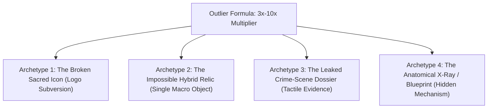

# YouTube 3x–10x Outlier Thumbnail Intelligence
*Reverse-Engineering Breakthrough Video Essays from Viewstats & 1of10*

---

## 🏛️ 1. Why 50-50 Splits Hit a Ceiling (And What Outliers Actually Do)

50-50 splits (*Before vs. After, Good vs. Bad*) are the most common template on YouTube. Because thousands of channels use them, **algorithmic novelty has decayed**.

When analyzing channels punching **3x to 10x above their subscriber baseline** (Magnates Media, Moon, Johnny Harris, Fern, Veritasium), data from *Viewstats* and *1of10* shows that outlier performance is driven by **4 specific non-split visual archetypes**:



---

## 🚀 2. The 4 Outlier Archetypes (With Copy-Paste Prompts for Ideogram 2.0)

---

### Archetype 1: The "Broken Sacred Icon" (BMW Hood Coin-Slot)
* **The Psychology:** Subverts an untouchable symbol of luxury status. Viewers are conditioned to see luxury car badges as symbols of wealth. When they see a coin-slot or toll meter welded directly into the brand emblem, their brain screams: *"WHAT did they do to this car?!"*
* **Composition:** Extreme cinematic macro shot of a pristine, gleaming metallic car hood. Right in the center, where the luxury roundel emblem sits, the metal is physically cut open with an illuminated mechanical brass arcade coin slot. A human hand is about to drop a shiny gold coin into the car's hood.

#### 📋 Copy-Paste Prompt for Ideogram 2.0 (Set to 16:9, Style: Realistic):
```text
A cinematic macro YouTube thumbnail photograph, 16:9 widescreen. Extreme close-up of the pristine, glossy black metallic hood of a luxury sports car under dramatic studio lighting. Centered on the hood, the luxury circular emblem is physically converted into a mechanical arcade coin-slot, illuminated with a glowing neon red backlight. A sharp human hand holds a shiny metallic coin hovering millimeters above the slot, about to insert it. Deep obsidian black reflections, dramatic warm amber rim light skimming the sculpted car hood curves, 85mm lens, extreme shallow depth of field with soft dark background bokeh, photorealistic, 8k resolution, zero floating text, completely textless.
```

---

### Archetype 2: The "Impossible Hybrid Relic" (The Credit Card Key Fob)
* **The Psychology:** The "Single Relic" formula (Viewstats #1 outlier trigger). Merges two familiar objects into an impossible hybrid that delivers the thesis in 100 milliseconds: *"The key to your car is now a credit card."*
* **Composition:** A high-tech modern key fob resting on a dark, reflective marble slab under a single dramatic overhead beam of light. But the metal key blade is physically replaced by a serrated **black titanium credit card chip**, and etched directly onto the key casing in crisp illuminated digital text is: `"MONTHLY RENTAL: $18.00"`.

#### 📋 Copy-Paste Prompt for Ideogram 2.0 (Set to 16:9, Style: Realistic):
```text
A striking macro product photograph for a high-CTR YouTube thumbnail, 16:9 widescreen. A luxury black sports car key fob resting on an empty, polished dark marble table under a single dramatic overhead spotlight. The metal key blade is physically replaced with a real gold electronic credit card chip and magnetic strip seamlessly fused into the key. Etched into the key fob casing in crisp illuminated cyan digital lettering is "$18/MO". Deep moody shadows, intense golden and cyan edge rim lighting, razor-sharp focus on the micro-textures of the key and gold chip, 8k resolution, professional documentary aesthetic.
```

---

### Archetype 3: The "Leaked Crime-Scene Dossier" (Johnny Harris / Veritasium Style)
* **The Psychology:** Signals deep investigative journalism and leaked corporate secrets. It elevates a mundane consumer complaint into a corporate conspiracy thriller.
* **Composition:** Top-down 45-degree angle of a dark wooden detective desk under a harsh single overhead interrogation lamp beam. A manila file folder stamped `CONFIDENTIAL` in red ink. Inside: A leaked corporate document with black redaction marker lines, paper-clipped to a high-contrast glossy photo of a BMW heated seat with a yellow sticky note written in black sharpie: *"Charge $18/mo. They can't stop it."* A red pushpin with red string connects the memo to a Wall Street revenue multiplier chart.

#### 📋 Copy-Paste Prompt for Ideogram 2.0 (Set to 16:9, Style: Realistic):
```text
An investigative documentary YouTube thumbnail shot, top-down 45-degree perspective of a dark wooden desk under a single harsh overhead desk lamp. In the center is an open manila folder stamped "CONFIDENTIAL" in faded red ink. Inside the folder is an official leaked corporate memo with heavy black redaction marker lines, paper-clipped to a glossy color photograph of a luxury car seat. A bright yellow sticky note is stuck to the photo with handwritten black marker text reading: "Charge $18/mo". A red pushpin and red investigative string connects the memo to a Wall Street stock chart. Deep cinematic shadows, tactile paper textures, 35mm film grain, 8k resolution, realistic investigative journalism aesthetic.
```

---

### Archetype 4: The "Anatomical X-Ray / Hidden Kill-Switch" (Fern / Wendover Style)
* **The Psychology:** The "Iceberg / Hidden Secret" formula. Shows the viewer what corporations are secretly hiding beneath the glossy exterior.
* **Composition:** A sleek black luxury sports car parked in an empty minimalist dark concrete studio. The body of the car is partially transparent with a glowing digital holographic X-ray cutaway showing the interior wiring. Glowing bright crimson red circuits run directly from the driver's heated seat into an illuminated digital lock module labeled "REMOTE LOCK". Glowing fiber-optic light trails rise from the module into the dark ceiling. High visual contrast, deep obsidian shadows with vibrant neon cyan and crimson accents, Octane render depth, photorealistic, 8k resolution, clean composition.
```

---

## ⚡ Which Archetype to Test First?

* **For pure, unignorable shock:** **Archetype 1 (The Coin Slot on the Car Hood)**. Nobody scrolling through YouTube has ever seen an arcade coin slot carved into a luxury car hood. It stops the thumb instantly.
* **For an investigative documentary thriller feel:** **Archetype 3 (The Leaked Crime-Scene Dossier)**. Johnny Harris and Veritasium have pulled tens of millions of views with this exact formula.

